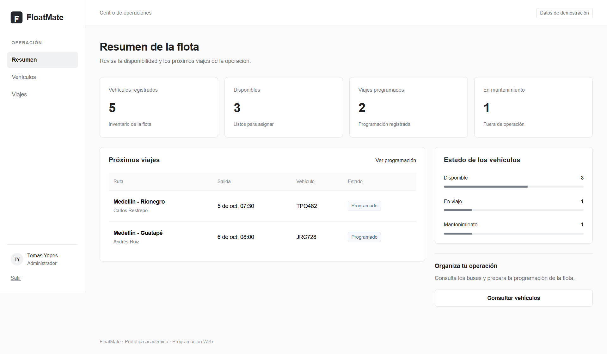

# FloatMate

Aplicación para gestionar flotas de buses. Esta primera versión incluye el **login y el resumen de la flota**, siguiendo los mockups del proyecto.

El acceso se valida en Laravel y la sesión se conserva en archivos locales. El panel presenta datos de demostración. **Esta versión no utiliza base de datos.**



## Estado actual

- Acceso con usuario y contraseña, mensajes de error y opción de mostrar u ocultar la contraseña.
- Sesión verificada en el servidor, resumen protegido y cierre de sesión.
- Indicadores, próximos viajes y estado de los vehículos con datos de ejemplo.
- Interfaz adaptada a computador y móvil.

Vehículos y Viajes aparecen en el menú para conservar el diseño. Sus pantallas y formularios quedan para otra entrega; los controles están deshabilitados.

## Tecnologías

| Parte | Tecnologías |
|---|---|
| Interfaz | Next.js 16, React 19, JavaScript y JSX |
| Servidor | Laravel 13 y PHP 8.4 |
| Estilos | CSS y Bootstrap local |
| Pruebas | PHPUnit y Playwright |

Las versiones exactas están fijadas en `frontend/package-lock.json` y `backend/composer.lock`.

## Estructura

```text
Floatmate/
├── frontend/        Login, resumen, componentes y estilos de Next.js
├── backend/         Acceso, sesión y API de Laravel
├── docs/            Documentación, capturas y resultados de pruebas
├── .github/         Comprobaciones automáticas del proyecto
├── .gitignore       Exclusiones de dependencias y archivos locales
└── README.md        Presentación y pasos para comenzar
```

## Requisitos

- Node.js **22 o superior**, con npm.
- PHP **8.4**, con las extensiones que requiere Laravel.
- Composer **2**.

Comprueba las herramientas desde una terminal de VS Code:

```powershell
node --version
npm --version
php --version
composer --version
```

Si alguna no se reconoce, instala la herramienta o revisa su configuración en `PATH` y abre una terminal nueva. La primera instalación de dependencias necesita internet.

## Instalación inicial

Clona este repositorio o descarga y descomprime su ZIP. En **VS Code → Archivo → Abrir carpeta**, abre la carpeta que contiene `frontend` y `backend`.

En **Terminal → Nueva terminal**, desde la raíz del proyecto:

```powershell
cd backend
composer install
Copy-Item .env.example .env
php artisan key:generate
```

Abre una segunda terminal desde la raíz:

```powershell
cd frontend
npm ci
Copy-Item .env.example .env.local
```

Estos pasos se hacen al preparar una copia nueva. Conserva los archivos `.env` generados; no hace falta copiarlos ni cambiar la clave en cada inicio. No ejecutes migraciones ni crees una base de datos.

> En macOS y Linux, usa `cp` en lugar de `Copy-Item`.

## Cómo abrir FloatMate desde VS Code

### 1. Iniciar Laravel

Abre **Terminal → Nueva terminal**. Desde la raíz del proyecto, ejecuta:

```powershell
cd backend
php artisan serve --host=127.0.0.1 --port=8000
```

Cuando aparezca `Server running on http://127.0.0.1:8000`, el servidor estará listo. **Deja esa terminal abierta.**

### 2. Iniciar Next.js

Pulsa el botón **+** del panel de terminales para abrir otra terminal. Desde la raíz, ejecuta:

```powershell
cd frontend
npm run dev
```

Si esa terminal se abre dentro de `backend`, usa `cd ../frontend` en lugar de `cd frontend`.

Cuando aparezca `http://127.0.0.1:3000`, la interfaz estará lista. **Deja también esa terminal abierta.**

### 3. Abrir el navegador

Mantén presionada **Ctrl** y haz clic en el enlace de Next.js, o abre [http://127.0.0.1:3000](http://127.0.0.1:3000).

| Campo | Acceso de demostración |
|---|---|
| Usuario | `admin` |
| Contraseña | `floatmate123` |

El puerto **3000** muestra FloatMate; el **8000** atiende las solicitudes de Laravel. Usa siempre `127.0.0.1` para mantener la sesión en el mismo dominio. Este proyecto se inicia con esos dos servidores, no con Live Server.

### 4. Detener la aplicación

Presiona **Ctrl + C** en cada una de las dos terminales.

## Comprobaciones

Pruebas del servidor, desde `backend`:

```powershell
composer test
```

Compilación de la interfaz, desde `frontend`:

```powershell
npm run build
```

Recorrido en navegador, con Laravel y Next.js iniciados, desde `frontend`:

```powershell
npx playwright install chromium
npm run test:e2e
```

GitHub Actions compila Next.js y ejecuta las pruebas de Laravel en cada push y pull request.

## Documentación

- [Guía completa del proyecto](docs/DOCUMENTACION.md): estructura, funcionamiento, configuración y solución de problemas.
- [Resultados de las comprobaciones](docs/VALIDACION.md).
- [Capturas de PC y móvil](docs/capturas).
- `docs/Documentacion.html`: guía para abrir localmente en un navegador.

## Próximos pasos

Desarrollar las pantallas de los módulos, sus formularios, el sistema de usuarios y permisos y la conexión a PostgreSQL. Esas funciones todavía no forman parte de esta versión.

## Equipo

Tomás Yepes · Cristian Benites · Mateo Gallo.

Proyecto académico en desarrollo. Las credenciales son públicas y sirven para probar la demostración. Las dependencias conservan sus licencias; FloatMate no concede una licencia general de código abierto.
